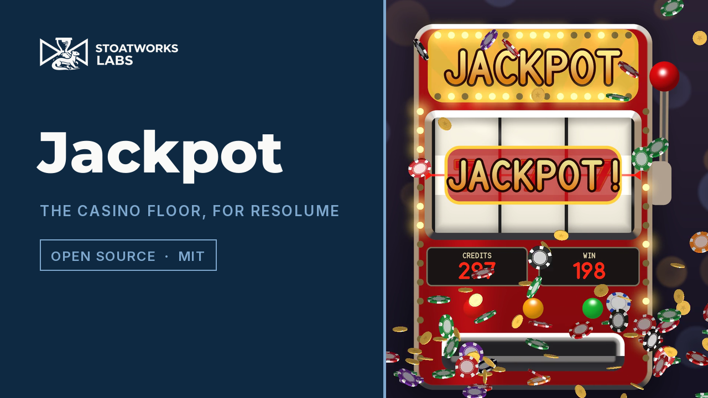
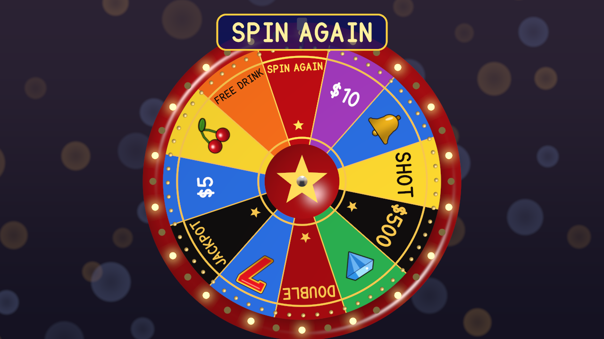

# jackpot

> **AI-assisted project.** This codebase was created with [Claude](https://claude.com/claude-code)
> (Anthropic), directed and reviewed by a human author. It's been loaded into
> **Resolume Arena 7.27.1 on macOS** and played there, and it passes the fleet's Arena checks on
> Windows. Everything else is measured by an offline harness that drives the real plugin code
> without a host. The full rundown, and the list of things I haven't tried yet, is under
> [Status](#status).

A thoroughly rigged casino for Resolume Arena and Avenue, as two FFGL plugins: **SW Jackpot**,
a source, and **SW Jackpot Over**, which does the same over your clip. There's a one-armed
bandit, a roulette wheel, the money wheel, a craps table and the lottery drum, and chips and
coins raining down whenever somebody wins. Press **Play** and the game plays out with proper
physics, then comes to rest on a random result, or the one you picked, at exactly **Spin Time**
or on the next beat or bar. Handy for when the client wants the big reveal on the downbeat and
the prize to go to table six.

Three sevens on the line: the banner, the meters counting the 200 credits in,
and the shower a jackpot sets off. Rendered by the plugin's offline harness
(`jptest`) rather than captured from Resolume.

<!-- downloads:start -->

## Download

**[v0.1.1](https://github.com/stoatworks-labs/jackpot/releases/tag/v0.1.1)** — prebuilt for macOS and Windows. Pick your platform:

<b>macOS</b> — Universal (Apple Silicon + Intel)

| Build | Download | Size |
| --- | --- | --- |
| Universal (Apple Silicon + Intel) · .dmg disk image | [`jackpot-0.1.1-macos-universal.dmg`](https://github.com/stoatworks-labs/jackpot/releases/download/v0.1.1/jackpot-0.1.1-macos-universal.dmg) | 1.5 MB |
| Universal (Apple Silicon + Intel) · .zip archive | [`jackpot-macos-universal.zip`](https://github.com/stoatworks-labs/jackpot/releases/latest/download/jackpot-macos-universal.zip) | 1.3 MB |

<b>Windows</b> — x64

| Build | Download | Size |
| --- | --- | --- |
| x64 · .exe installer | [`jackpot-0.1.1-windows-x86_64-setup.exe`](https://github.com/stoatworks-labs/jackpot/releases/download/v0.1.1/jackpot-0.1.1-windows-x86_64-setup.exe) | 427 KB |
| x64 · .zip archive | [`jackpot-windows-x86_64.zip`](https://github.com/stoatworks-labs/jackpot/releases/latest/download/jackpot-windows-x86_64.zip) | 675 KB |

All builds, checksums and release notes: [github.com/stoatworks-labs/jackpot/releases](https://github.com/stoatworks-labs/jackpot/releases).

macOS builds are signed and notarised and open normally. The Windows builds are unsigned, so SmartScreen warns once.

<!-- downloads:end -->

*[Watch it](https://www.youtube.com/watch?v=-s5chJo2Idc) (68 seconds): the slot machine's
jackpot and the shower, a near miss, five reels of sevens and bars, roulette landing on 17, the
money wheel on the joker, craps on 11 at the come-out, the lottery drum drawing six, a fountain
of chips and coins, and the Over effect on one of Resolume's demo clips with the clip on the
reels. It's all the plugins' own output. An FFGL plugin doesn't have a window to film, so the
footage comes from this repo's offline harness (`jptest --film` and `--over --pipe`) rather
than a screen recording of Resolume.*

## The one idea

**Every casino game is decided before you see it, and every one has a symmetry
the physics can't see.** So each game is simulated honestly, ahead of time, and
then the paint gets turned so the result is whatever you asked for:

| game | what decides it | what the physics cannot see |
| --- | --- | --- |
| Slots | the random number at the pull — true of every machine since Telnaes's virtual reel (US 4,448,419, 1984); the reels are a display | nothing needed: the stops ARE the result, and the reels are driven to them |
| Roulette | the ball, in a real wheel | the rotor's 37 (or 38) frets are identical: turn the numbered ring by whole pockets |
| Money wheel | the clapper on the pegs | 54 identical pegs: turn the painted segments by whole segments |
| Craps | two dice off the pyramids | each die's rotation group (polyhedral's engine): draw it as R(t)·S |
| Lottery | the air in the drum | identical balls: deal the numbers out to them |

The motion you see is exactly what the physics did. Only the numbers have moved,
and you never see them move: on roulette the croupier's hand spins the rotor up
before the ball goes in and takes the ring round on the way, on the money wheel it
happens in the pull before it's let go, and in the lottery the drum is empty
between draws, so the new balls drop in already painted. Random results come from
an integer generator weighted the way the real game is, Fixed ones come from you,
and both go through the same trick.

What you get for free:

- **Near misses, honestly.** A Random pull on the *Virtual* strip draws each reel's
  stop on 64 virtual stops over 22 physical ones, the blanks beside the seven worth
  six each and the seven one. The seven sails past just above or below the line
  twelve times for every time it lands, against twice on a fair strip, because
  that's how the real machines are built (the swines). *Near Miss* asks for one
  outright.
- **Motion blur from the shutter**, not a filter: each reel's strip is integrated
  over the frame's exposure, so at speed the symbols smear into streaks and
  sharpen as the reel brakes into its detent, which bounces as a damped spring.
- **The roulette ball leaves the track when it has to**: held against the lip only
  while v² ≥ g r tan 14°, then down the stator, off a diamond if it meets one,
  across the frets of the counter-turning rotor, and into a pocket.
- **The money wheel's slowdown is the clapper**: every peg bends the leather and
  takes about 1.4 J, so the wheel ticks slower and slower and may rock back off
  the last peg.
- **Craps that knows the game**: come-out, point, the puck ON and OFF,
  seven-out; Win, Lose, Jackpot (11 on the come-out, the point made the hard way)
  and Near Miss read against the point the table is on.
- **The lottery as an air-mix machine**: a jet carries the balls up the middle and
  they fall back down the glass; when the tube opens, the first ball under the
  mouth goes up it and rolls along the rack.
- **Chips and coins as rigid discs**: tumbling in the air, bouncing, rolling on
  edge and, as they lean over, whirring faster and faster like Euler's disk
  before they slap flat into the pile, which tidies itself up, each piece fading
  12 s after it was thrown.

Every game at rest on its result, with the result board above it. Rendered by
`jptest`.

## Results

Result is read against **the player's bet**, which is whatever Fixed Number is set to (a
money wheel from a file reads it differently: see [Wheel files](#wheel-files)):

| | Slots | Roulette | Money wheel | Craps | Lottery |
| --- | --- | --- | --- | --- | --- |
| Random | weighted as the strip | each pocket 1 in 37 (38) | each segment 1 in 54 | each die 1 in 6 | each ball alike |
| Win | any paying line but the jackpot | the bet's number | the bet's value | a winning roll for the point | the bet drawn |
| Jackpot | sevens across | the bet's number | joker or logo | 11 on the come-out; the point made (the hard way on 4, 6, 8, 10) | the bet drawn last |
| Near Miss | two sevens, the third beside the line | a pocket beside the bet | beside the joker or logo | 6 or 8 on the come-out; one off the point | the number beside the bet |
| Lose | nothing paid, no near miss | anything but the bet | anything but the bet or the top | craps, or seven-out | the bet not drawn |
| Fixed | Fixed Number is the symbol (0 blank … 10 seven, 11 diamond) | the number (37 is 00) | the value | the total | the bet drawn first |

The slot machine pays from the left: three or more of a symbol (seven 200, diamond
100, triple bar 60, double bar 40, bar 20, bell 18, melon 15, plum 14, orange and
cherry 10, lemon 8; four in a row ×4, five ×20), mixed bars 10, a cherry on the
first reel 2 and two cherries 5. A pull costs a credit; the meter starts at 100.

## Wheel files

*New since v0.1.1, not released yet* ([jackpot#1](https://github.com/stoatworks-labs/jackpot/issues/1),
VJPandaAU's idea). The money wheel can wear your own values: a plain `.txt` file, one value a
line, chosen with **Wheel File**.

    *JACKPOT
    $5
    🍒
    FREE DRINK
    %SPIN AGAIN
    $10

`tools/fixtures/showcase.txt` on 12 segments, at rest on SPIN AGAIN. Rendered by
`jptest`.

- **Segments** (2–54) is how many there are. With more lines than that, **Lines** picks
  them: *In Order* takes the first ones, *Random* (the default) shuffles every line by Seed
  and takes what it needs. The shuffle changes only when the file, Seed, Segments, Lines or
  Short File does, never between spins, so you can load a wheel and spin it all night. Change
  any of them mid-spin and the spin lands on the wheel it started with; the result then stays
  up for 3.5 seconds before the new wheel goes on. Play always spins the new one.
- With fewer lines than segments, **Short File** repeats them round the wheel (*Repeat*, the
  default) or makes the wheel that many segments, two at the least (*Fewer Segments*).
- **Markers.** A leading `*` makes a segment the jackpot (black, a gold star), a leading `%`
  the joker (red, a gold star). The marker isn't printed. Neither character is in the plugin's
  type, so there's no way to print a literal one either, and nothing to escape.
- **Only marked segments win.** A `*` is the jackpot (On Jackpot's shower, the red board), a
  `%` a win (On Win, the blue board), and anything else a loss. A file with no markers never
  wins.
- **The type shrinks to fit.** Up to 12 segments a label is set across its segment, level
  when it's at the top; from 13 it's stacked a character under another, as the Big Six's own
  are. Labels are cut at 32 characters on 2 segments, 24 on 3–4, 16 on 5–8, 12 on 9–12, 8 on
  13–40 and 7 on 41–54; the result board shows the line whole, up to 32.
- **What prints:** capitals, digits and `$'+-.:/!`. Lowercase comes out in capitals, accents
  come off (Café is CAFE), curly quotes and dashes become straight ones, and anything else
  (`%`, `&`, `£`, `€`, commas) is left out.
- **Emoji.** 🍒 🍋 🍊 🔔 🍉 💎 7️⃣ on a line on their own paint the slot machine's cherries,
  lemon, orange, bell, melon, diamond or seven on the segment. Inside text an emoji is left out
  like any other character the type hasn't got, and any other emoji on its own leaves the
  segment blank.
- **Results:** Win lands on a marked segment, Jackpot on a `*`, Near Miss on an unmarked
  segment beside a `*`, Lose on an unmarked one, and Fixed on the line numbered Fixed Number,
  counted the way your editor counts lines (blank ones included). Ask for something the wheel
  hasn't got (Jackpot with no `*`, or a line Random left off) and you get a Random play, and
  the log says so.
- **When it won't load.** A missing file, one that isn't text, or one with nothing in it
  leaves the Big Six on the wheel, and the plugin's log (and Resolume's) says why; so does a
  file whose values the type can't print at all (Cyrillic, say), which loads as blank
  segments. UTF-8 with or without a BOM, UTF-16 with a BOM and old Windows-1252 files all
  read. A file is read when it's chosen; choose it again after editing it and it's read again
  (if its size or date has changed).
- **Segments with no file** makes a smaller Big Six: the joker first, the logo opposite it
  from four segments up, and the money values between them in the Big Six's order.

## Controls

- **Game:** Game (*Slots*, *Roulette*, *Money Wheel*, *Craps*, *Lottery*, *Shower
  Only*), **Play**, Spin Time (1–20 s), Land On (*Time*, *Beat*, *Bar* — the first
  boundary at least Spin Time away), Result, Fixed Number, Seed, Auto Play and
  Interval (2–120 s).
- **Slots:** Reels (*3*, *5*), Symbols (*Fruit*, *Sevens and Bars*, and on the
  effect *Clip*: the clip where the seven would be), Strip (*Virtual*,
  *Physical*), Blur (the shutter), Reel Bounce.
- **Roulette:** Wheel (*European*, *American*), Rotor Speed, Deflectors.
- **Money wheel:** Clapper (the leather's stiffness). *New since v0.1.1, not released yet:*
  Segments (2–54), Wheel File (a `.txt`, one value a line), Lines (*In Order*, *Random*) and
  Short File (*Repeat*, *Fewer Segments*); see [Wheel files](#wheel-files).
- **Craps:** Pyramids (the back wall's rubber), Puck.
- **Lottery:** Balls (10–75), Draw (1–7), Air.
- **Shower:** Shower (*Off*, *On Win*, *On Jackpot*, *Always*), **Shower Now**,
  Pattern (*Rain*, *Fountain*, *Burst*, *Pour*), Pieces (*Chips*, *Coins*,
  *Mixed*), Amount, Piece Size, Pile.
- **Look:** Backdrop (*None* — transparent on the source, the clip on the effect —
  *Felt*, *Dark*), Felt Colour, Accent Colour, Lights, Display (the slot
  machine's banner and the other games' result board), Font, Font File, Font
  Name, Light Angle, Tilt (20° to straight down; the lottery is seen 35° lower),
  Zoom.
- **Over only:** Mix.

**Fonts travel by name**, as in polyhedral: the dropdown stores an index into
*this* machine's list, Font Name keeps the family, and the name wins when a
composition restores both.

## Status

**v0.1.1, 2026-10-12, and still early days** (v0.1.0 came out on 2026-10-09). User guide:
[stoatworks-labs.com/software/jackpot/guide](https://stoatworks-labs.com/software/jackpot/guide/).

**New in v0.1.1:** the shower's pile clears itself (jackpot#3: every piece
fades 12 s after it is thrown, the oldest go early when the pool is nearly full, pieces
off the table front or back are gone, and the height field drains with the pile) and
Game and Play sit at the top of the panel, outside the Game group (jackpot#2). Both
are measured by the harness below (`--pile`, `--names`). The pile's clearing was also run
in Resolume Arena 7.27.1 on Windows (software rendering, a build of the 0.1.1 code made with MSVC on the lab machine, 2026-10-12);
I haven't looked at where Play sits in Resolume yet.

**New since v0.1.1, not released yet: wheel files** (jackpot#1). Segments, Wheel File, Lines
and Short File are measured by the harness below (`--wheel-file`, `--wheel-draw`,
`--wheel-custom`, `--wheel-geometry`, and the wheel rows of `--wheel-readback`, `--duration`
and `--determinism`). **I haven't loaded them into Resolume yet**, on a Mac or on Windows, and
the Windows way of opening a file whose path isn't ASCII has been checked only as far as the
UTF-16 conversion, here. At the defaults (no file, 54 segments) both plugins draw what v0.1.1
drew, to the byte: 4,500 frames over ten scenes, the money wheel's Random, Jackpot, Fixed,
Near Miss and Auto Play among them, compared with the v0.1.1 harness.

**In Resolume Arena 7.27.1 on macOS** (this Mac, Apple M4 Max, 2026-10-09): Arena's log
registers `'SW Jackpot' uid: JP01 category: 3` and `'SW Jackpot Over' uid: JP02
category: 1`, each loading in under half a second. SW Jackpot dropped into a clip
showed the slot machine at 1920×1080 with every control group; Result *Jackpot* and
Play landed three sevens at Spin Time with the banner, the meters counting 200 in and
the shower raining; switched to Roulette, the ball ran the track and came to rest on
7 RED, the bet's number, under the result board. The plugin's own log recorded both
plays as asked and no warning or error. I didn't try the Over effect, the other three
games, Land On against Arena's transport or a saved composition there. `oxbow
probe` reads the bundles as a host does and `oxbow selftest` renders through each. No
OpenFX port, no browser demo.

**In Resolume Arena 7.27.1 on Windows** (win-lab, Mesa llvmpipe, no GPU,
2026-10-09): a CI build of this source loads from Extra Effects, `SW Jackpot`
registers as `JP01`, a source, and `SW Jackpot Over` as `JP02`, an effect; all 50
and 52 host controls match the declaration in name, order, type, range and default
(the two names at Resolume's 16-character limit complete); both render, with a font
loaded from file, and Arena's log stays clean through the run: **17 passed, 0 failed**
of the fleet gate's checks. The gate never presses Play, so it can only show the
controls that change an idle picture: 25 on the source and 27 on the effect did,
none read dead, and Font File alone was inconclusive. The 16 that act only on a play
(Spin Time, Land On, Result, Fixed Number, Seed, Strip, Blur, Reel Bounce, Rotor
Speed, Clapper, the lottery's Balls, Draw and Air, Display, Auto Play and Interval)
were not measured there. Software rendering says nothing about a GPU or about speed.

What's measured, on this Mac:

| | |
| --- | --- |
| slots | every Result on 3 and 5 reels, both symbol sets, 1,632 pulls: every reel at rest **exactly** on its drawn stop, the reels stopping left to right with the last at Spin Time; the pay table against eight lines worked by hand from this README |
| near miss | 400,000 pulls a strip, reel 3: the seven on the line 0.01534 (table 1/64 = 0.01562), the blanks beside it 0.18848 (12/64 = 0.18750); Physical 0.04520 and 0.09168 (1/22, 2/22). **12.3** near misses per jackpot seven on the virtual reel, **2.0** on a fair strip |
| blur | at 0.70 stops a frame, the reels are **0.007–0.011** (mean per channel) from the strip integrated over the shutter and 0.158 from the instant; at rest 0.034–0.055 from the sharp strip; 320×180 and 640×360 |
| slots readback | **192** payline symbols read out of the picture against the symbol atlas, 0 wrong, 320×180 and 640×360 (the closest call 1.3× on the pixels where two symbols differ) |
| roulette | every number of both wheels, Fixed: the ball at rest in the pocket painted with it, 75 of 75; the rotor turned 1, 5, 18 and 36 pockets, the ball's path **bit-identical**; ten releases leave the lip within **0.47%** of v² = g r tan 14°; Random chi-square 41.6 and 33.3 (critical 68.1, 69.4); the ball's top never above 73.4 mm, the lip drawn to 80 |
| roulette readback | the number painted under the ball and beside it, **40 of 40** read from the picture, both wheels, two rasters |
| money wheel | every value, Fixed, 35 spins over 18 segments; the wheel turned 1, 7, 27 and 53 segments, the pegs and the clapper **bit-identical**; every one of 114 peg passages took energy, the median 1.46 J against the bearing's 0.058 J a segment; Random chi-square 65.1 over the segments (critical 90.6), 8.0 over the values (22.7); 14 of 14 read from the picture |
| wheel files (not released) | 9 texts read as expected: markers, blank lines counted, LF, CRLF and CR, a BOM, UTF-16 LE and BE, Windows-1252, the seven emoji, the folding; 6 bad files (a PNG, control characters, empty, blank, over 1 MB, missing) refused with the reason and the Big Six kept; 1,500 lines capped at 1,000 values; a file named in Latin, Cyrillic and emoji read here, and its path converted to the UTF-16 a Windows open takes, matching the compiler's own |
| wheel draw (not released) | In Order clockwise, so the clapper meets the lines in order; Random 24 different lines of 80, the same for a Seed, keeping its 24 when Segments goes to 25; over every Seed, which lines are drawn chi-square 24.7 and which lands first 27.9 (critical 58.4); Short File both ways; the cut at every size; through the plugin, six spins on one draw, Seed changing it and changing it back, an edited file read again with its lines in the same places |
| wheel results (not released) | 128 plans on wheels of 2, 8, 12, 24, 37 and 54 from a file and the Big Six on 2 and 13, every Result: each at rest on the segment drawn, read under the clapper as painted; only marked segments win, and a file with no markers never does; Random chi-square under critical on every wheel; **C_P** bit-identical for 37, 48, 56 and 72 pegs; 6 s spins at warp 0.91–1.06 |
| wheel geometry (not released) | 2, 8, 24 and 54 segments of awkward labels (34 W's, 20 eights, symbols, markers), from the pixels: each arc within 0.0051 rad of 2π/N; **no** ink in a neighbour's segment or within a divider and a pixel of one; the type 20–74 px tall at 1080p. Read under the clapper: 24 Fixed lines on wheels of 2 to 54, two rasters, 0 wrong |
| craps | every total 2–12, 44 throws: the faces on top of the dice **as drawn** add up to it; every throw reached the back wall, every die flat on the felt, none inside the other; the pass line through a scripted shooter; Win and Lose against every point, 84 of 84 |
| lottery | 16 draws of 10 to 75 balls: the rack, left to right, shows the numbers drawn; the paint a permutation every time; every drawn ball rises up the tube; balls never overlap more than 1.75 mm (bound 3) nor leave the glass; Random chi-square 41.3 (critical 84.1) |
| shower | a coin falling face on for 1.5 s within 0.009 of the closed form under quadratic drag (bound 0.019, g T dt); a tumbling chip keeps its angular momentum to 0.48% while its axis wobbles; 0.96 million contact steps, none added energy; **every one of 362 pieces judged**: 249 at rest (247 flat within 1°, 2 laid as they lay, steeper than the 16° gate), 75 gone off the frame or the table, 38 still rolling and none of those stuck; **Euler's disk**: the contact's rate within 6% of Ω² = 4 g / (r sin α) from 7° to 1.3° of lean, rising 2.5× |
| pile | chips, three presses of Shower Now, coins, three more, then quiet: **0 of 1,223** pieces left 30 s after the last (0.1.0: 743 of 1,080, 363 of them chips); Always at Amount 1.0 for a minute, **4,000 of 4,000** thrown in its last 10 s (0.1.0: 234), and still 4,000 after twelve minutes in a longer run; no piece ever past the table's edge in z (0.1.0: 21.9 frame heights past); the table flat once the pile has gone and after Pile off and on (0.1.0: 0.029 and 0.049 left) |
| duration | every game, Spin Time 3, 6 and 12 s: at rest at Spin Time, moving a frame before, still after; the money wheel also on 2, 8, 24, 36 and 37 segments (54, 56, 48, 72 and 37 pegs); Land On, 64 waits each ending on a beat or bar boundary |
| Over | the clip (premultiplied, alpha and all) untouched where there is no game and everywhere at Mix 0, to 1.2×10⁻⁷ |
| the rest | defaults, names (unique as Arena addresses them, no '/'; Game and Play outside every group, each group one run of ids), determinism (the same seed is the same play to the bit), resize mid-shower, fonts by name, missing and by file, credits and the craps point carried between plays, the roulette ring never jumping at a Play, and a slot pull mid-spin carrying the reels on from where they are |
| tables | the dice's face loops, groups and labels identical from arm64 with fused multiply-adds, arm64 without, and x86_64 (polyhedral's check) |
| negative controls | **37** deliberately wrong models, **all 37** detected (13 of them for the wheel files) |
| mutants | **17** one-character changes (four GLSL, thirteen C++), **all 17** caught |
| dead controls | **50** parameters over both plugins, all live |

Render cost (`jptest --bench`, mid-play, the median frame on an Apple M4 Max on a
machine shared with other builds, the range over two runs), 720p / 1080p / 4K:
slots **0.5 / 0.8 / 1.7–1.8 ms**; roulette **2.0–2.2 / 4.1–4.2 / 5.3–5.4**; money
wheel **0.3 / 0.7 / 1.4**; craps **1.2–1.3 / 2.2–2.3 / 2.5–2.6**; lottery, 49 balls,
**0.6–0.7 / 1.2–1.5 / 3.4**; a constant shower **1.0 / 1.2 / 2.3**. A money wheel of 54
from a file of 80 long lines (not released) **0.4–0.9 / 0.5–0.7 / 1.4**, the Big Six's cost
within the bench's noise (three runs each against v0.1.1's harness). Up to 1080p every 3D pixel takes four rays; above it only the pixels on an
edge do. A play is planned on a worker, so it starts a frame or two after the
press: craps **1 ms**, roulette **13**, the lottery **47** (49 balls), the money
wheel **55** (worst 82).

What **isn't** verified yet:

- **Wheel files haven't been anywhere near Resolume** (they're not released either). Nor has
  a Windows machine opened one from a folder with a non-ASCII name: that path is checked here
  only as far as converting it to UTF-16.
- **Two plays in Arena on a Mac, and a Windows check that never presses Play.**
  No game has been played on Windows yet. Nothing here has met Arena's transport
  (whether `barPhase` is a usable downbeat hasn't been measured anywhere in the
  fleet, and Land On trusts it), the order Arena restores parameters in from a saved
  composition, or any GPU but mine.
- **The physics is my own, checked but not fitted.** The roulette ball is a point
  carrying its radius on a profile of cones, with one friction for each surface;
  the clapper is a spring that straightens at a third of its stiffness; the
  lottery's air is a jet, a trace of swirl and some turbulence; the chips are
  single-point contacts. Each is checked against the law it should obey (the
  departure, the energy, Euler's disk), not against footage of real casino kit. The
  constants were picked because they looked right, which is the scientific method
  as practised in Resolume.
- **Roulette's frets are flush with the pockets' rims** and stop at the steps'
  feet. When they stood proud of the apron, the end of a fret once caught the ball
  and held onto it forever, which isn't how roulette is meant to go.
- **Craps throws are a stickman's ordinary ones** (1.9–2.5 m/s) and settle in under
  a second. A longer Spin Time is met by the shooter's hold after the sweep and at
  most a 0.6× slow motion, never by throwing harder.
- **Short Spin Times are played fast.** The lottery takes 2 s just to load 49 balls,
  so a 3 s draw plays at about 3×; a 3 s money-wheel spin at up to 1.6× (1.9× on 37 to 40
  segments, which have the fewest pegs).
- **The slot machine and the money wheel are drawn face on in 2D**; roulette,
  craps and the lottery are ray-traced 3D. Light Angle and Tilt act on those three
  and the shower only.
- **A piece settling into the pile is turned flat**, by up to 11° (the gate is
  16°); one that stops steeper, leaning on a step of the pile, stays as it lies.
  The pile is a height field, not a stack of bodies: when a piece fades, the
  field is rebuilt and those lying on it drop onto what is under them.
- **Above 1080p, edges the 2×2 pixel quads cannot see are single-sampled**: an
  edge between two quads is one ray, not four.

## Build

C++17 + GLSL 4.10, CMake, FFGL 2.1 (SDK vendored as a submodule). macOS builds
are universal (arm64 + x86_64); Windows needs GLEW via vcpkg.

    git clone --recursive https://github.com/stoatworks-labs/jackpot
    cmake -B build -DCMAKE_BUILD_TYPE=Release
    cmake --build build
    cmake --install build          # both bundles into Resolume's Extra Effects

## Building and testing

The offline harness renders the real plugin classes headlessly, planning each
play on the render thread so every run is the same run:

    ./build/jptest --out /tmp/jackpot.png                      one play to rest
    ./build/jptest --over --out /tmp/over.png                  the effect, on a card
    ./build/jptest --set "Game=Roulette" --set "Result=Fixed" --set "Fixed Number=17"
    ./build/jptest --slots            every Result, reels on their stops, the pay table
    ./build/jptest --nearmiss         the virtual reel against its table
    ./build/jptest --blur             the strip integrated over the shutter
    ./build/jptest --slots-readback   the payline read out of the pixels
    ./build/jptest --roulette         every pocket, C37, the departure, Random
    ./build/jptest --roulette-readback  the number under the ball, from the pixels
    ./build/jptest --wheel            every value, C54, the clapper, Random
    ./build/jptest --wheel-readback   the segment under the clapper, from the pixels
    ./build/jptest --wheel-file       what a wheel file becomes, and what falls back
    ./build/jptest --wheel-draw       In Order, Random, Short File, the draw holding between spins
    ./build/jptest --wheel-custom     every Result on wheels of 2 to 54, who wins, C_P
    ./build/jptest --wheel-geometry   equal segments, every label inside its own, from the pixels
    ./build/jptest --craps            every total, the throw, the pass line
    ./build/jptest --lottery          the rack, the permutation, the drum
    ./build/jptest --shower           flight, energy, the pile, Euler's disk
    ./build/jptest --pile             the pile clears, stays on the table, never stalls
    ./build/jptest --duration         every game at rest at Spin Time
    ./build/jptest --defaults --names --determinism --over-check --resize --fonts --state
    ./build/jptest --negative         every check above against a wrong model
    ./build/jptest --offline          the no-GL subset and its negative controls (what CI runs)
    ./build/jptest --shaders --out DIR  every program, written out and through this Mac's driver
    tools/mutate.sh                   one character changed, a check must fail
    python3 tools/sweep.py            no control is silently dead
    ./build/jptest --bench            720p through 4K, and the planners' cost
    tools/verify.sh                   all of it, in about five minutes

`--set` takes an option by its name or its index, and refuses a value that is
neither. Filming uses the fleet's frame format and cue sheets (a press of Play is
three cues, 0 1 0, or `--play N`):

    ./build/jptest --film 600 --size 1280x720 --play 10 --set "Game=Roulette" \
      | ffmpeg -f rawvideo -pix_fmt rgba -s 1280x720 -r 60 -i - roulette.mp4

<!-- attributions:start -->
This project is built on other people's work — see [ATTRIBUTIONS.md](ATTRIBUTIONS.md).
<!-- attributions:end -->

## Licence

MIT.

The craps dice are polyhedral's engine; the virtual reel is Telnaes's; the contact
solvers are sequential impulses (Catto); the unbiased draws are Lemire's; the
ray–primitive intersections follow Quilez; the glyph distance fields are
stb_truetype's. Nothing is copied from anyone's source but the vendored headers
in `external/`.
