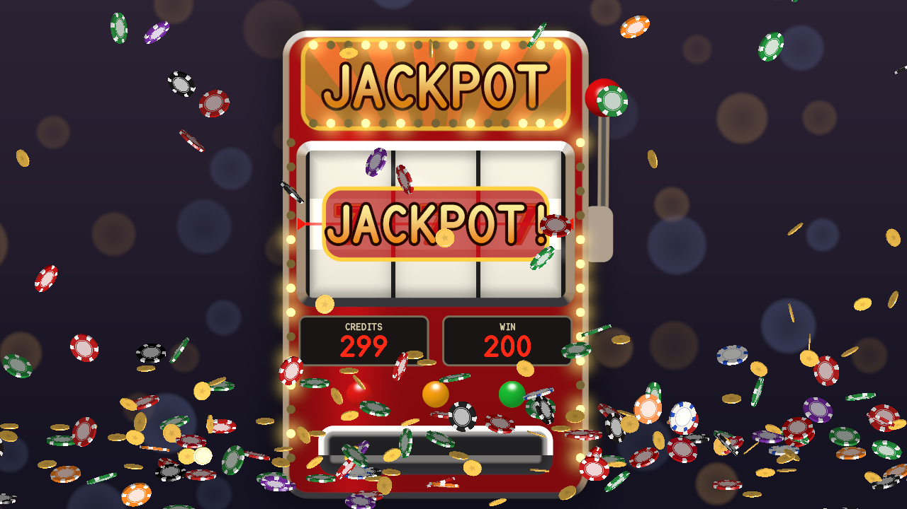
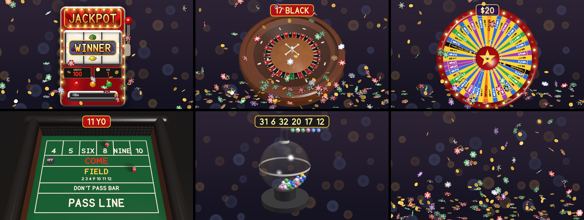

# Jackpot user guide

Jackpot is a casino floor for [Resolume](https://resolume.com) Arena and Avenue, as two FFGL
plugins: **SW Jackpot**, a source, and **SW Jackpot Over**, which does the same over your clip.
It has a one-armed bandit, a roulette wheel, the money wheel, a craps table and the lottery drum,
and when you press **Play** the game plays out with proper physics and comes to rest on a random
result, or the one you set, at exactly the Spin Time you set or on the next beat or bar.

Chips and coins come showering down on a win, and since you get to pick the result, it's the one
casino where the house does as it's told.



*Three sevens on the line, the banner, the meters counting the win in, and the shower a jackpot
sets off. Rendered by the plugin's offline harness rather than captured from Resolume.*

> **Before you rely on this:** released at **v0.1.1**, and still early days. It's been loaded
> into Resolume Arena 7.27.1 on a Mac and played there: a slot jackpot and a roulette spin, each
> landing as asked, with the shower. On Windows, both plugins load, register and render in
> Resolume Arena 7.27.1, with every control as declared, on a machine with software rendering
> and no GPU; no game was played there. Everything else is measured by a harness that drives
> the real plugin classes in a headless GL context. Every number of both roulette wheels, every
> value of the money wheel and every craps total was played, and each came to rest as asked; the
> harness then reads the result **out of the rendered picture** for the slot machine, the
> roulette wheel and the money wheel. Every game stops at exactly Spin Time. Twenty-four models
> that are wrong on purpose are all detected, twelve one-character changes to the shipped code are
> all caught, and all 46 controls across the two plugins measurably do something. v0.1.1's
> shower fix was run in Resolume Arena 7.27.1 on Windows (software rendering, a build of the 0.1.1
> code made with MSVC on the lab machine, 2026-10-12): with Shower
> Only on Always, chips showered, then coins, the chips were gone about 14 s after the switch, the
> shower kept falling, and the floor was clear 15 s after Shower Off. **Play**'s place at the top of
> the panel is measured by the harness only. Try it on a spare layer before you put it in a show.
>
> This codebase was created with AI assistance, directed and reviewed by a human author.

---

## Installing

Every download has **both plugins** in it, the source and the effect. On macOS they're
`Jackpot.bundle` and `Jackpot Over.bundle`; on Windows, `Jackpot.dll` and `Jackpot Over.dll`. Put
both into Resolume's effects folder and restart Resolume:

```
macOS    ~/Documents/Resolume Arena/Extra Effects/
Windows  %USERPROFILE%\Documents\Resolume Arena\Extra Effects\
```

Avenue uses the same layout under its own folder name. **SW Jackpot** then turns up among the
sources and **SW Jackpot Over** among the effects.

The macOS download is a universal build (Apple silicon and Intel), as a `.dmg` or a `.zip`. It's
**Developer ID-signed and notarised**, so the bundles just load. The Windows download is an x64
installer or a `.zip`. It isn't code-signed, so the installer trips SmartScreen once: **More
info** → **Run anyway**.

---

## Two plugins

- **SW Jackpot** (a source) draws the game on its own. With **Backdrop** on *Dark* (the default)
  it stands in a dark room with the casino's lights out of focus behind it; *Felt* puts it on a
  green table; *None* draws nothing behind the game, so it goes over whatever's underneath.
- **SW Jackpot Over** (an effect) draws it over the clip it's on. Its **Symbols** list has one
  more entry, **Clip**, which puts the clip itself on the slot machine's reels where the seven
  would be.

The effect declares every one of the source's controls and adds **Mix** at the end, after About,
so a look built on one carries across to the other.

---

## How a result is chosen

Every casino game is decided before you see it, and every one has something the physics can't
tell apart. A roulette rotor's thirty-seven pockets are identical, the money wheel's fifty-four
pegs are identical, a die looks the same from every face, and lottery balls are all alike. Jackpot
uses that. When you press Play it plays the game honestly, ahead of time (the ball on the track,
the wheel against its clapper, the dice off the back wall, the balls in the air) until it comes
to rest. It reads where it came to rest, and then turns **the paint**: the numbered ring, the
painted segments, the die's faces, which number is printed on which ball, so that what you see
there is the result you chose.

Every bounce, every tick of the clapper and every ball you watch is the physics' own. Only which
number is painted where has moved, and you never see it move: on the roulette wheel the
croupier's spin of the rotor before the ball goes in takes the ring round, on the money wheel it
happens in the pull before it's let go, and the lottery's drum is empty between draws, so the new
balls drop in already numbered.

The slot machine doesn't need any of that. Since the 1980s a slot's result has been decided by its
random number generator the moment the handle goes down, and the reels have just been a display.
The plugin does the same and drives the reels to the stops.

So a chosen result looks every bit as random as a Random one, and a Random result is drawn by the
plugin, weighted the way the real game is, rather than left to however the physics happened to go.

---

## Start here

1. Put **SW Jackpot** on a layer. You'll see a red fruit machine in a dark room.
2. Press **Play** (map it to a key, a MIDI note or a Stream Deck button). The handle goes down,
   the reels spin and stop one after another, and the last one stops at Spin Time, 4 seconds
   later. A win lights the banner, counts the credits in and showers chips.
3. Choose a **Game**: *Slots*, *Roulette*, *Money Wheel*, *Craps*, *Lottery*, or *Shower Only*.
4. For a chosen outcome, set **Result** (*Win*, *Jackpot*, *Near Miss*, *Lose* or *Fixed*) and,
   where it applies, **Fixed Number**. Press Play and the game lands on it.
5. Set **Land On** to *Beat* or *Bar* to have every play come to rest on the beat.

On roulette, the money wheel, craps and the lottery the play starts a frame or two after the
press, because the game is worked out on another thread first (about 1 ms for craps, 13 for
roulette, 47 for the lottery with 49 balls and 55 for the money wheel, 82 at worst).

---

## Game, Play and the Game group

**Game** and **Play** sit at the top of the panel, outside every group, so Play's there to
press with all the groups closed. The **Game** group under them holds the rest, from Spin Time to
Interval.

- **Game:** *Slots*, *Roulette*, *Money Wheel*, *Craps*, *Lottery*, *Shower Only*. Changing it
  lays the new game out at once, at rest.
- **Play:** the button. A press while a game is still playing starts another from where it is.
  On *Shower Only*, Play is a burst of chips.
- **Spin Time:** 1 to 20 seconds from Play to rest, default 4. See *Spin Time* below.
- **Land On:** *Time* (exactly Spin Time), *Beat* or *Bar*, meaning the first beat or bar of
  Resolume's tempo at least Spin Time away.
- **Result:** *Random*, *Win*, *Jackpot*, *Near Miss*, *Lose*, *Fixed*. Each game reads them
  against the bet, which is Fixed Number:

| | Slots | Roulette | Money wheel | Craps | Lottery |
| --- | --- | --- | --- | --- | --- |
| Random | weighted as the strip | each pocket alike | each segment alike | each die alike | each ball alike |
| Win | any paying line but the jackpot | the bet's number | the bet's value | a winning roll | the bet drawn |
| Jackpot | sevens across | the bet's number | joker or logo | 11 on the come-out; the point made (the hard way on 4, 6, 8, 10) | the bet drawn last |
| Near Miss | two sevens, the third beside the line | a pocket beside the bet | beside the joker or logo | 6 or 8 on the come-out; one off the point | the number beside the bet |
| Lose | nothing paid, no near miss | anything but the bet | anything but the bet or the top | craps, or seven-out | the bet not drawn |
| Fixed | Fixed Number is the symbol | the number (37 is 00) | the value | the total | the bet drawn first |

- **Fixed Number:** the bet, 0 to 99. On the slot machine it names a symbol: 0 blank,
  1 cherry, 2 lemon, 3 orange, 4 plum, 5 bell, 6 melon, 7 bar, 8 double bar, 9 triple bar,
  10 seven, 11 diamond. On the money wheel a value it doesn't have goes to the nearest one
  (1, 2, 5, 10, 20; 40 is the joker, 45 the logo).
- **Seed:** 0 to 9999. The same seed replays the same sequence of plays.
- **Auto Play** and **Interval:** plays by itself, every 2 to 120 seconds (default 10).
  Switching Auto Play on plays at once.

---

## The slot machine



*Every game at rest on its result, with the result board above it.*

A three- or five-reel fruit machine with a handle, a marquee of chasing lamps, the credit and win
meters and three buttons. Each reel carries 22 stops: eleven symbols with a blank between each
pair, and a seven at stop 0.

- **Reels:** *3* or *5*.
- **Symbols:** *Fruit* (cherries, lemon, orange, plum, bell, melon, bar, seven), *Sevens and
  Bars* (single, double and triple bars, cherry, diamond, seven), and on the effect *Clip* (the
  fruit, with the clip where the seven would be).
- **Strip:** *Virtual* or *Physical*; see below.
- **Blur:** the camera's shutter, from a still frame (0) to the whole frame time (1, a 360°
  shutter). At speed the symbols smear into streaks and sharpen as the reel brakes.
- **Reel Bounce:** how lively the detent is when it catches a reel, from dead (0) to a few
  springy bounces (1).

**It pays from the left:** three or more of a symbol (seven 200, diamond 100, triple bar 60,
double bar 40, bar 20, bell 18, melon 15, plum 14, orange 10, cherry 10, lemon 8, with four in a
row paying four times that and five twenty times), any three bars mixed 10, a cherry on the first
reel 2 and two cherries 5. A pull costs a credit, and the meter starts at 100.

**The near miss is real.** On the *Virtual* strip a Random pull draws each reel's stop from 64
virtual stops mapped onto the 22 physical ones unevenly: the seven gets one, and each blank beside
it gets six. So the seven goes sailing past just above or below the line twelve times for every
time it lands on it (against twice on a fair strip), because that's how slot machines have been
built since Inge Telnaes's patent in 1984. *Physical* makes every stop equally likely.

---

## The roulette wheel

A wooden bowl, the ball track and its lip, the stator with eight diamond deflectors, the rotor
with its numbered ring, its pockets and the frets between them, and the turret. The ball runs
round the track against the lip until it's too slow to stay up, spirals down the stator, can
strike a diamond, rattles across the frets of the rotor turning the other way, and settles.

- **Wheel:** *European* (37 pockets, a single zero) or *American* (38, with 00), in their real
  order.
- **Rotor Speed:** how fast the croupier spins the rotor, up to about 38 turns a minute.
- **Deflectors:** the eight diamonds on the stator, on or off.

The croupier spins the rotor up before releasing the ball, and the ring turns on between plays.
The result board shows the number and its colour once the ball's at rest, and the winning pocket
glows.

---

## The money wheel

The Big Six: a big wheel of 54 segments (24 ones, 15 twos, 7 fives, 4 tens, 2 twenties, a joker
and a logo), a brass peg between each pair, and a leather clapper at the top that the pegs push
past. Each peg bends the leather and takes energy from the wheel, so it ticks slower and slower
and may rock back off the last peg.

- **Clapper:** how stiff the leather is. Stiffer takes more from each peg and stops the wheel
  sooner, so the operator pulls it harder.

---

## The craps table

The end of the table by the back wall: the layout (the point boxes 4, 5, SIX, 8, NINE, 10; COME;
FIELD; DON'T PASS BAR; PASS LINE), the rubber pyramids on the back wall and the puck. The stick
sweeps the last roll's dice away, the shooter throws, and the dice hit the back wall and come to
rest on the layout.

- **Pyramids:** the back wall's rubber pyramids, on or off.
- **Puck:** the ON/OFF puck, shown or not.

The table keeps its point from roll to roll: a come-out 7 or 11 wins, 2, 3 or 12 is craps, and
anything else is the point and the puck goes ON; after that the point again wins and a 7 is a
seven-out. Result reads against the point the table is on.

---

## The lottery drum

A glass drum of numbered balls in the UK lotto's colours, a jet of air up the middle that carries
them to the top where they fall back down the glass, a tube at the top and a rack. The old balls
drain out of the bottom, the new ones drop in, the air comes on, and the tube takes one ball at a
time up to the rack.

- **Balls:** 10 to 75 in the drum (default 49).
- **Draw:** 1 to 7 balls drawn (default 6).
- **Air:** how hard the blower blows.

It takes about two seconds just to load 49 balls, so a draw shorter than about six seconds plays
fast.

---

## The shower

Chips and coins, each one a proper spinning disc: they tumble in the air, bounce, roll on their
edges and, as they lean over, whirr faster and faster before they slap flat (Euler's disk), then
land in a pile along the foot of the frame.

- **Shower:** *Off*, *On Win* (the default), *On Jackpot*, or *Always*.
- **Shower Now:** a burst, whatever the game is doing.
- **Pattern:** *Rain* across the frame, a *Fountain* from the bottom, a *Burst* from the middle,
  or a *Pour* from one place.
- **Pieces:** *Chips*, *Coins* or *Mixed*.
- **Amount:** how many fall each second, up to about 400.
- **Piece Size:** a chip's width as a share of the frame's height, 2% to 20%.
- **Pile:** on, the pieces settle into a pile; off, they fall out of the frame, and the pile
  there fades away in half a second.

**The pile clears itself.** Every piece fades twelve seconds after it was thrown (about ten
seconds lying in the pile), oldest first, so a win's pile is gone about fifteen seconds after the
shower began, and a run of wins keeps one pile that renews itself. A heavy or constant shower
fills the plugin's 900 pieces quickly, and then the oldest go early, in a fifth of a second, so
the shower never stops for want of room. A piece that rolls off the table, at the sides, the
front or the back, is gone. Changing **Pieces** doesn't sweep the table: the old kind fades out
with its age, within about twelve seconds. The twelve seconds are fixed, not a control.

*Shower Only* as the Game is the shower on its own, and Play is a burst.

---

## The Look group

- **Backdrop:** *None* (nothing behind the game: transparent on the source, the clip on the
  effect), *Felt* (a green table) or *Dark* (a dark room with the casino's lights out of focus).
- **Felt Colour:** the table's cloth, on the felt and on the craps layout.
- **Accent Colour:** the slot machine's cabinet and the money wheel's rim.
- **Lights:** the lamps, meaning the marquee's chase, the money wheel's rim and the glow on a
  winner.
- **Display:** the slot machine's banner and the other games' result board, on or off.
- **Font**, **Font File**, **Font Name:** the type on the meters, the banner, the layout and the
  numbers: *Built-in* (the same on every machine), any installed font, or a font file. **Fonts
  travel by name:** the list's position means a different font on another computer, so the family
  is kept in Font Name, and when a composition restores both, the name wins.
- **Light Angle:** where the key light comes from, round the scene (roulette, craps, the lottery
  and the shower).
- **Tilt:** how high the camera looks from, 20 degrees to straight down (roulette, craps and the
  lottery; the lottery is always seen 35 degrees lower, from in front).
- **Zoom:** closer or wider.

---

## SW Jackpot Over

Everything above, over the clip. **Mix** fades between the clip alone (0) and the clip with the
game (1). Where the game draws nothing the clip comes through untouched, alpha and all.

**Symbols: Clip** puts the clip on the slot machine's reels in place of the seven, so a jackpot is
three of your clip.

---

## Spin Time

Every game comes to rest at exactly Spin Time (or on the beat or bar it was sized for). Each game
first aims its own natural length at it (the ball's speed, the pull on the money wheel) and then
plays what it simulated a little faster or slower so it stops on time, easing in slow motion.

- **Slots** always runs at real speed: the reels are driven to stop at Spin Time.
- **Roulette** and **the money wheel** are thrown to take about Spin Time on their own.
- **Craps** never throws harder to fill time. Dice thrown down a table settle in under a second
  however hard they're thrown, so a long Spin Time is the shooter holding the dice a moment
  after the sweep and at most a gentle slow motion.
- **The lottery** needs time to load and mix, so a short draw plays fast.

---

## Time comes from the host

The games move on the host's clock, so a paused composition freezes a play. A step backwards in
the host's clock, or a jump forward of more than a quarter of a second (a clip trigger or a
scrub), passes no time, and the play carries on from where it was. For the first few frames after
it loads, the plugin runs on its own steady clock while it works out whether the host counts time
in seconds or milliseconds.

---

## Performance

Measured by the offline harness on an Apple M4 Max, mid-play, the median frame, on a machine
shared with other builds:

| | 720p | 1080p | 4K |
| --- | --- | --- | --- |
| slots | 0.5 ms | 0.8 ms | 1.7–1.8 ms |
| roulette | 2.0–2.2 ms | 4.1–4.2 ms | 5.3–5.4 ms |
| money wheel | 0.3 ms | 0.7 ms | 1.4 ms |
| craps | 1.2–1.3 ms | 2.2–2.3 ms | 2.5–2.6 ms |
| lottery, 49 balls | 0.6–0.7 ms | 1.2–1.5 ms | 3.4 ms |
| a constant shower | 1.0 ms | 1.2 ms | 2.3 ms |

Up to 1080p every pixel of roulette, craps and the lottery takes four rays; above it only the
pixels on an edge do. Nothing was timed inside Resolume.

---

## If it looks wrong

**Nothing happens when I press Play.** On roulette, the money wheel, craps and the lottery the play
starts a frame or two after the press, and comes to rest at Spin Time; at 20 seconds that's a long
spin. A paused composition freezes it.

**I asked for Jackpot and got something else.** Check the Result row actually reached the plugin:
the log records every play's result (below). Then check Fixed Number: on roulette Jackpot and Win
are the bet's number, and on the money wheel a value the wheel doesn't have goes to the nearest one.

**The lottery plays very fast.** Spin Time is shorter than loading and mixing the balls takes. Give
it six seconds or more.

**The dice are in slow motion.** Spin Time is longer than a throw. The plugin plays the throw up to
a little slower and holds the dice before it, but no longer than that.

**My font changed on another computer.** The font isn't installed there, so the text uses the
built-in face, and Font Name still holds the name.

**The effect does nothing at all.** A shader that won't compile looks just like that. The actual
message is in the log:

```
macOS    ~/Library/Logs/jackpot/jackpot.YYYY-MM-DD.log
Windows  %LOCALAPPDATA%\jackpot\logs\jackpot.YYYY-MM-DD.log
```

It records the GL vendor, renderer and version at load, a shader that failed, the font in use (and
a named font that isn't installed), and every play: the game, its result, and how much it was
slowed or sped up.

---

## What is verified, and what is assumed

**In Resolume Arena 7.27.1 on a Mac** (v0.1.0): both plugins load and register; SW Jackpot in a
clip shows every control; a slot Jackpot and a roulette spin landed as asked, with the shower and
the result board.

**In Resolume Arena 7.27.1 on Windows** (software rendering, no GPU): both plugins load and
register, every control is as declared, both render with a font loaded from file, and Resolume's
log stays clean. Every control that can change the picture without a play was seen doing so
(25 on SW Jackpot, 27 on SW Jackpot Over). No play was pressed there, so the games themselves
haven't run on Windows.

**Measured**, on an M4 Max under macOS, by the offline harness driving the real plugin classes:
every reel at rest exactly on its stop, every Result honoured and the pay table as written above;
the near miss twelve times a jackpot on the virtual reel and twice on the physical one; the reels'
blur the strip integrated over the shutter; the payline read out of the picture; every number of
both roulette wheels at rest under the ball, and read out of the picture; turning the rotor by whole
pockets leaving the ball's path identical to the bit, and the ball leaving the track at the speed the
physics of a banked track says; every money-wheel value under the clapper, and the clapper taking the
energy; every craps total on the dice as drawn, and the pass line; the lottery's rack showing the
numbers drawn; the chips' fall, tumble, bounce, pile and Euler's whirr against the laws they should
obey; the pile clearing within thirty seconds of the last shower, no piece left off the table, a
constant shower at full Amount still throwing everything asked of it after a minute, and the
table flat again once the pile has gone or Pile is switched off and on; Game and Play outside every
group; Random fair by chi-square; every game stopping at Spin Time and on the beat; the clip untouched
by the effect where it must be. Every check also runs against a model that's wrong on purpose and
must fail it, and a sweep fails if any control does nothing.

**Assumed, or not verified:**

- **Two plays in one Resolume, on one Mac, and none on Windows.** The Over effect, the money wheel,
  craps and the lottery, Land On against Resolume's tempo, and a saved composition's restore
  haven't been tried in a host, and nor has any play on Windows or on a GPU there.
- **Play's place at the top of the panel (v0.1.1)** is measured only by the harness. That Resolume
  draws Game and Play outside the groups follows from how it groups parameters; I haven't looked
  at it. The pile's clearing was run in Resolume Arena 7.27.1 on Windows (software rendering, a build of the 0.1.1 code made with MSVC on the lab machine, 2026-10-12), with Shower Only, not after a game.
- **The physics is my own**, checked against the laws it should obey, not against film of real
  casino equipment. Every friction, bounce and stiffness is chosen to look right.
- **The roulette frets are flush with the pockets' rims**, and the ball is a point carrying its
  radius.
- **A piece that comes to rest within 16 degrees of flat is laid flat** (by up to about eleven, in
  practice); a steeper one, leaning on a step of the pile, stays as it lies. The pile is a height
  field, not a stack of bodies: when a piece fades, those lying on it drop onto what's under it.
- **The same seed gives the same results everywhere**, because they come from the plugin's own
  random numbers or your bet. The motion itself may differ between a Mac and a Windows machine.
- **The inspector shows slider positions**, not seconds or degrees. This guide gives the ranges.
- **No OpenFX version, no presets.**

---

## About

The last group in the source's panel, **About**, has the plugin's name, version, licence and
maker, and buttons that open this guide, the project page, the source on GitHub and the support page
in your browser. In the effect, Mix comes after it.

## Links

- Project page: [stoatworks-labs.com/software/jackpot](https://stoatworks-labs.com/software/jackpot/)
- Source: [github.com/stoatworks-labs/jackpot](https://github.com/stoatworks-labs/jackpot)

## Reporting something

Open an issue at [github.com/stoatworks-labs/jackpot/issues](https://github.com/stoatworks-labs/jackpot/issues).
A screenshot, the Game and Result, any controls you moved, whether it was the source or the effect,
and the composition's resolution and frame rate are usually enough to go on.
